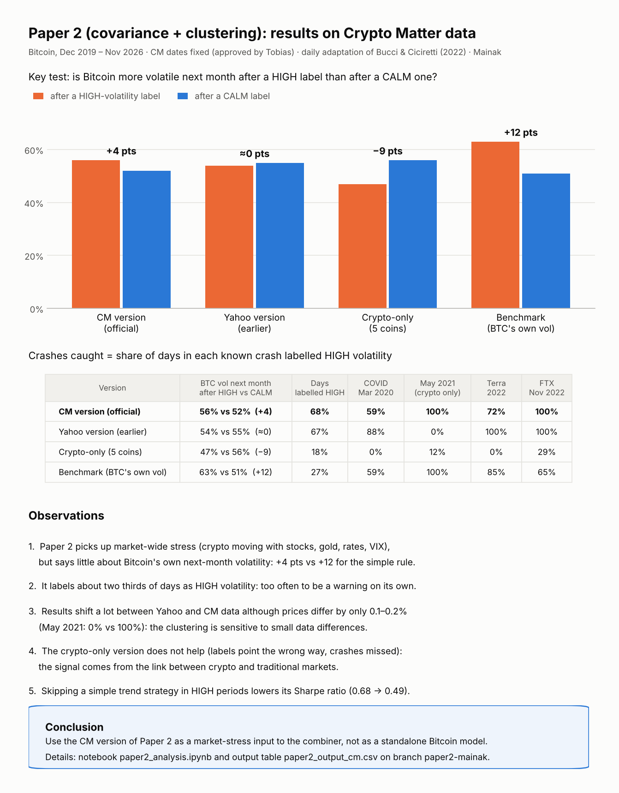

# Paper 2 model: market regimes from co-movement (covariance + clustering)

Part of the Crypto Matter × Frankfurt School project "AI-Driven Market Regime Detection".
Owner: Mainak. Paper: Bucci & Ciciretti (2022), *Market regime detection via realized
covariances*, Economic Modelling 111 (preprint: arXiv 2104.03667).

## Latest results (23 Nov 2026, Crypto Matter data up to 22 Nov 2026)

**Full analysis:** [`paper2_analysis.ipynb`](paper2_analysis.ipynb) (all tables, charts, observations and
conclusion are visible on GitHub without running anything).
**Output table for the combiner:** [`outputs_notebook/paper2_output_cm.csv`](outputs_notebook/paper2_output_cm.csv)
(`date, p_bull, p_bear, p_low_vol, p_high_vol`).

**In short:** on Crypto Matter data with the corrected dates, Paper 2 picks up market-wide stress
but separates Bitcoin's next-month volatility only weakly (56% after a HIGH label vs 52% after CALM),
less than a simple rule based on Bitcoin's own volatility (63% vs 51%). It labels about two thirds
of days as HIGH, and a crypto-only basket does not help. Recommended use: a market-stress input to
the combiner, not a standalone Bitcoin regime model.

## The idea in one paragraph
In a crisis, assets swing harder **and** start moving together. The paper measures that with
covariance matrices of a basket of assets, compresses them with PCA, and uses hierarchical
clustering to split time into two regimes: **calm** and **highly volatile**. We do the same on
daily data, with Bitcoin inside a small basket, and turn the result into the team's standard
output: `date, p_bull, p_bear, p_low_vol, p_high_vol`. This is a daily adaptation of the paper,
not a replication of its hourly realized covariance (Crypto Matter provides daily data only).

See `docs/architecture_team_pipeline.png` and `docs/architecture_paper2_model.png`.

## Files
| File | What it does |
|---|---|
| `paper2_analysis.ipynb` | **Main analysis notebook**: Paper 2 on Crypto Matter data (dates fixed) vs the Yahoo version, a crypto-only basket and a simple benchmark, with observations and conclusion |
| `config.py` | Every setting: basket, window, refit schedule, smoothing, costs |
| `fetch_data.py` | Downloads daily prices from Yahoo Finance (BTC, ETH, S&P 500, gold, US 10Y yield, VIX) into `data/` |
| `cm_data.py` | Downloads Crypto Matter data (Close, Market_cap, Trade_volume) and writes a data-quality check |
| `check_cm_dates.py` | Compares Crypto Matter's dates with Yahoo, year by year, for each coin |
| `data_prep.py` | Loads, checks and aligns prices; turns them into daily returns |
| `features.py` | Rolling 21-day covariance, turned into volatilities + correlations |
| `model.py` | PCA + Ward clustering, monthly walk-forward, probabilities, smoothing |
| `backtest.py` | Regime vs. what the price did, transitions, crash-period check, trading test |
| `plots.py` | Charts |
| `run_paper2.py` | Runs the Yahoo version end to end and writes `outputs/` |
| `experiments.py` | Optional: model variants vs. a simple BTC-volatility benchmark |
| `simulate_data.py` | Optional: fake data with known calm/stress periods (a test of the code) |

## How to run
1. `pip install -r requirements.txt`
2. `python fetch_data.py` (Yahoo market data, no key needed)
3. Put the Crypto Matter key in the terminal, never in code: `$env:CM_API_KEY = "your-key"` (PowerShell),
   then `python cm_data.py --coins bitcoin ethereum litecoin binancecoin monero`
4. Open `paper2_analysis.ipynb` (Jupyter or VS Code) and **Run All** (about 1 minute; the notebook needs no key).
   Results are saved in `outputs_notebook/`.
5. Optional: `python check_cm_dates.py --coins bitcoin ethereum litecoin binancecoin monero` (date check),
   `python run_paper2.py --compare` (Yahoo version, writes `outputs/`).

`data/` is not in Git: the scripts recreate it.

## Crypto Matter data notes
* **Dates:** from 28 Jan 2018 to 22 Nov 2023, Crypto Matter's CreationDate is one day after the
  closing day (checked against Yahoo for BTC, ETH, LTC, BNB, XMR). The notebook moves those dates back
  one day (approved by Tobias, 21 Nov 2026). After the fix, CM and Yahoo BTC returns match on the same
  date in every year (correlation 0.96–1.00).
* **Zeros:** zero prices (same month-end dates for every coin, e.g. 31 Dec 2014, 29 Feb 2016) are treated as missing.
* **Gaps:** at most 3 missing days in a row (BNB once 4); gaps of up to 3 days are filled with the last price.

## Outputs of the notebook (in `outputs_notebook/`)
| File | Meaning |
|---|---|
| `paper2_output_cm.csv` | Team table, Crypto Matter version (the official Paper 2 output) |
| `paper2_output_crypto_only.csv` | Team table, crypto-only version (for reference) |
| `comparison.csv` | All metrics for the four versions |
| `chart_next_month_volatility.png` | The key test: BTC volatility next month after HIGH vs CALM labels |
| `chart_regimes_cm.png`, `chart_regimes_crypto_only.png` | BTC price with the high-volatility periods shaded |

## What we kept and what we changed
| Paper | Ours | Why |
|---|---|---|
| Hourly prices, monthly realized covariance | Daily prices, rolling 21-day covariance, updated daily | We only have daily data, and we need a daily answer |
| 9 (preprint) / 7 (published) futures | BTC, ETH, S&P 500, gold, US 10Y yield, VIX | Crypto plus the market around it |
| 3 principal components, Ward clustering, 2 regimes | Same | Faithful to the paper |
| Hard labels | Probability from distance to each cluster centre | The team output needs probabilities |
| Clusters fitted once | Refitted monthly on past data only | No look-ahead in the backtest |
| Manhattan distance | Euclidean (scikit-learn's Ward only supports Euclidean) | Library limit |

## Known limits
- No bull/bear: the model only separates calm from highly volatile markets.
- It captures market-wide stress rather than Bitcoin's own volatility, and labels about two thirds of days as HIGH.
- Results are sensitive to small data differences (Yahoo vs Crypto Matter), and cluster quality is weak (silhouette about 0.28).
- The rolling window reacts with a delay, so regimes start and end a little late; the first fits have only about 2 years of history.
- The published paper (clustering best) and the preprint (VLSTAR best) disagree; VLSTAR exists only in R (`starvars`) and is not included here.
